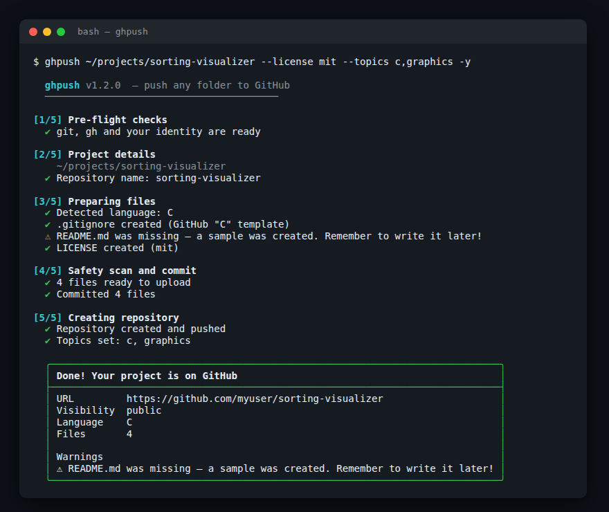
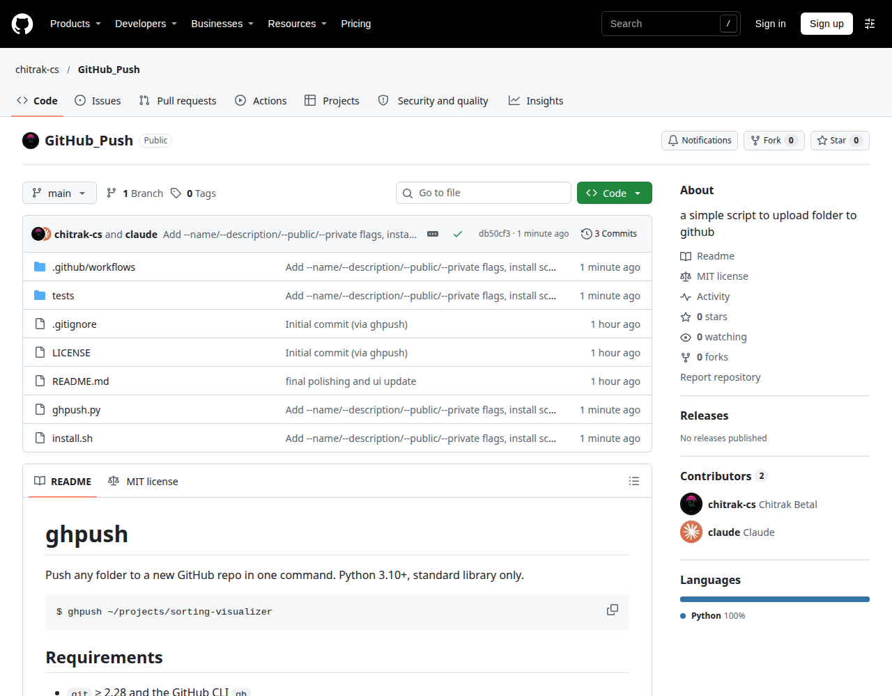
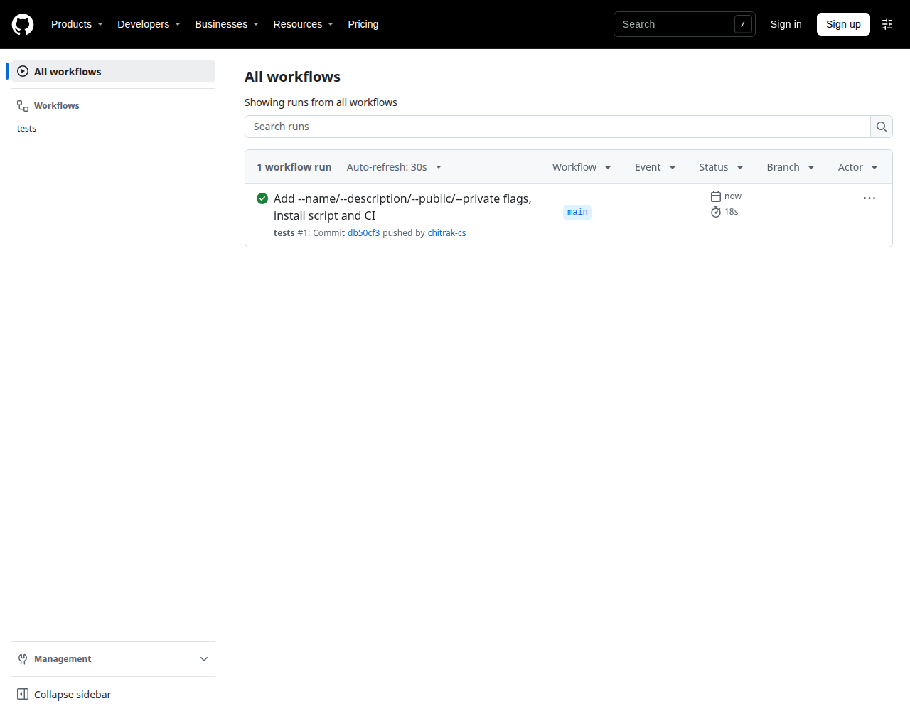

# ghpush

[](https://github.com/chitrak-cs/GitHub_Push/actions/workflows/tests.yml)


[](LICENSE)

**Push any folder to a brand-new GitHub repository with one command.**

`ghpush` checks your setup, asks a few questions, adds the files every repo needs
(`.gitignore`, `README.md`, optionally a `LICENSE`), scans for secrets, commits, then
creates the repository and pushes. Python standard library only — no `pip install`.

<p align="center">
  
</p>

> The terminal image above is a real run of `ghpush` against a stand-in `gh`, with the
> GitHub username replaced by a placeholder.

## Features

- **One command** — creates the repo and pushes, using the official GitHub CLI for login and tokens.
- **Language detection** — from marker files (`package.json`, `Cargo.toml`, …), then file extensions.
- **Smart `.gitignore`** — keeps yours if present; otherwise fetches GitHub's official template for the detected
  language, with an offline fallback. A secrets block is always included.
- **README safety net** — generates a sample README if missing and warns you to write a real one.
- **Safety scan** — flags `.env`, `*.pem`, `*.key`, `id_rsa*`, … and files over 100 MB *before* anything is
  committed, and offers to ignore them. Templates like `.env.example` are allowed.
- **Existing repos are respected** — history is kept, and an existing `origin` remote is never replaced without asking.
- **Script-friendly** — every question has a flag, so it also runs non-interactively.
- **Dry run** — see exactly what would happen without creating anything.

## Requirements

| Tool | Version | Install |
|---|---|---|
| Python | 3.10+ | preinstalled on Ubuntu |
| git | 2.28+ | `sudo apt install git` |
| GitHub CLI (`gh`) | any recent | `sudo apt install gh` |

Then log in once and set your git identity:

```bash
gh auth login        # GitHub.com → HTTPS → Login with a web browser
git config --global user.name  "Your Name"
git config --global user.email "you@example.com"
```

## Installation

```bash
git clone https://github.com/chitrak-cs/GitHub_Push.git
cd GitHub_Push
./install.sh
```

`install.sh` links `ghpush.py` into `~/.local/bin/ghpush` and tells you if that folder is not on your `PATH`.
Because it is a symlink, `git pull` updates the command too. Prefer not to install? Run `./ghpush.py` directly.

## Usage

```bash
ghpush ~/projects/sorting-visualizer          # interactive
ghpush .                                      # push the current folder
ghpush . --dry-run                            # preview, create nothing
ghpush . -n my-app -d "My app" --private -y   # fully non-interactive
ghpush . --license mit --topics c,graphics --web
```

| Flag | Effect |
|---|---|
| `folder` | Folder to push (asked for if omitted) |
| `-n`, `--name NAME` | Repository name; skips the question |
| `-d`, `--description TEXT` | Description; skips the question |
| `--public` / `--private` | Visibility; skips the question |
| `-y`, `--yes` | Accept defaults and skip confirmations. An existing `origin` remote aborts instead of being replaced |
| `--dry-run` | Do everything except create the repo and push |
| `--license mit\|gpl-3.0\|apache-2.0` | Add a LICENSE file (year and your git name filled in) |
| `--org NAME` | Create the repo under an organization |
| `--topics a,b` | Set GitHub topics after pushing |
| `--web` | Open the repo in your browser when done |
| `--version` | Print the version |

Output is coloured on a terminal; set `NO_COLOR=1` to turn colours off.

## How it works

```
 1  Pre-flight     git, gh, gh login, git identity
 2  Details        folder → repo name (checked against your repos) → description → visibility
 3  Files          detect language → .gitignore → README → LICENSE (if requested)
 4  Safety + git   git init → secret / large-file scan → confirm → commit
 5  GitHub         gh repo create --source --push → topics → summary
```

### Language detection

| Marker file | Template |
|---|---|
| `package.json` | Node |
| `Cargo.toml` | Rust |
| `go.mod` | Go |
| `pom.xml`, `build.gradle` | Java |
| `requirements.txt`, `pyproject.toml`, `setup.py` | Python |
| `CMakeLists.txt` | CMake + C++ |
| `composer.json` | Composer |

With no marker file, it counts source extensions (`.py .c .h .cpp .hpp .cc .java .js .ts .go .rs`) and picks the
most common, skipping `.git`, `node_modules`, `venv`, `.venv`, `build`, `dist` and `target`.

## This project on GitHub

`ghpush` was used to publish itself. The repository, with CI running the tests on Python 3.10 and 3.12:

<p align="center">
  
</p>

<p align="center">
  
</p>

## Project layout

```
ghpush.py             the whole program (single file)
install.sh            symlinks ghpush into ~/.local/bin
tests/                26 tests (unit + end-to-end)
.github/workflows/    CI: runs the tests on every push
docs/images/          screenshots used in this README
```

## Testing

```bash
python3 -m unittest discover -s tests -v
```

Unit tests build fake projects in temp folders and mock the network. The end-to-end tests run the real CLI against
a fake `gh` and a throwaway git identity, so they need no network, no GitHub account, and touch nothing real.

## Troubleshooting

| Message | Fix |
|---|---|
| `GitHub CLI (gh) is not installed` | `sudo apt install gh` |
| `You are not logged in to GitHub` | `gh auth login` |
| `git identity is not set` | Run the two `git config --global` commands above |
| `You already have a repository called …` | Pick another name (or pass a different `-n`) |
| `already has an 'origin' remote` | Answer `y` to replace it, or remove it yourself |
| `ghpush: command not found` | Add `export PATH="$HOME/.local/bin:$PATH"` to `~/.bashrc`, then restart the shell |

If a push fails halfway (for example, no internet), the local commit is harmless — just run `ghpush` again.

## License

[MIT](LICENSE)
